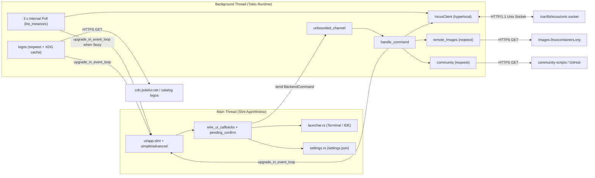

# IncusCubby — Architecture

Native Linux desktop GUI for managing local Incus/LXC developer sandboxes over `/var/lib/incus/unix.socket`. License: GPL-3.0-or-later (`LICENSE`).

---

## 1. Tech validation

### 1.1 Incus control path: Direct Unix socket REST vs CLI wrapping

| Criterion | Direct REST (`hyperlocal` + `hyper`) | Shelling out to `incus` CLI |
|---|---|---|
| Structured data & telemetry | Typed JSON structs from `/1.0/instances?recursion=2`, `/1.0/networks/*/leases`, `/1.0/storage-pools/*/resources`. | Requires parsing JSON/table CLI output per subcommand and spawning subprocesses every 3 s. |
| Error handling & diagnostics | Inspects `io::ErrorKind` (`PermissionDenied` / `NotFound`) and Incus API error codes directly. | Relies on exit codes and localized stderr text. |
| Interactive root shell | Not applicable over simple JSON REST without websocket PTY piping. | `incus exec <name> -- su -l root` inside the user's terminal emulator works natively. |

Decision:
- Use **`IncusClient`** (`hyper` 1.x + `hyper-util` + `hyperlocal` 0.9) against `/var/lib/incus/unix.socket` for every state query, lifecycle mutation, device/limit update, snapshot, file transfer, log fetch, non-interactive `exec`, image, profile, storage, and network operation.
- Shell out to `incus` **only** in `launcher::open_shell` when launching an interactive terminal window (`incus exec <name> -- su -l root`).

### 1.2 UI toolkit: Custom Precision Instrument Slint UI

- **Slint (`1.18`)** compiled ahead-of-time via `build.rs` (`slint_build::compile("ui/app.slint")`).
- Uses custom Precision Instrument components (`ui/theme.slint`, `ui/components.slint`, `ui/simple.slint`, `ui/advanced.slint`, `ui/app.slint`) with bundled Geist/Geist Mono TTF fonts (`ui/fonts/`), unified Lucide SVG icon set (`ui/icons/lucide/`), Simple/Advanced modes, and Dark Graphite / Light Studio themes.
- Slint runs its event loop on the main thread; all async Incus I/O runs on a dedicated OS thread hosting a multi-threaded Tokio runtime, pushing updates strictly through `slint::Weak<AppWindow>::upgrade_in_event_loop`.

---

## 2. System architecture



### 2.1 Repository layout

```
Cargo.toml                    # single crate ("incus-cubby"), edition 2024, pedantic clippy lints
build.rs                      # slint_build::compile("ui/app.slint")
deny.toml                     # cargo-deny GPLv3-compatible license, ban, and source gate
.github/
  workflows/{ci,release}.yml  # Linux CI and tagged x86_64/aarch64 GitHub release pipelines
  scripts/release-notes.py    # commit-categorized GitHub release notes generator
packaging/linux/              # .desktop, 512px PNG icon, AppImage/.deb/.rpm builders, PKGBUILD
ui/
  app.slint                   # AppWindow shell, data structs, confirmation & warning banners
  theme.slint                 # CubbyTheme tokens, Dark/Light palettes, fonts & icon helpers
  components.slint            # shared Precision Instrument widgets
  simple.slint                # Simple mode hub & quick-create flow
  advanced.slint              # Advanced mode views (sandboxes, create, infra, profiles, images, settings/about/legal)
  fonts/                      # bundled Geist & Geist Mono TTFs + OFL.txt
  icons/                      # CubbyMark, app icon, fallback SVGs, and lucide/ SVG set
src/
  main.rs                     # entrypoint, Tokio worker, polling loop, command dispatch, UI state sync
  launcher.rs                 # terminal emulator detection (incus exec) & brand-agnostic IDE launch
  logos.rs                    # async logo worker, XDG disk cache, SVG/raster decode, accent extraction
  settings.rs                 # XDG JSON config (terminal, IDE, simple_mode, light_theme) & PATH scanning
  incus/
    mod.rs                    # re-exports
    client.rs                 # IncusClient, HTTP/Unix transport, instances, devices, snapshots, exec
    community.rs              # community-scripts catalog fetcher, ct/ parser & container runner builder
    infra.rs                  # storage pools/volumes, networks/leases, profiles, logs, file push/pull
    models.rs                 # Incus 1.0 REST serde types + InstanceSummary/ImageSummary mappings
    packages.rs               # distro package upgrade/install argv builders + token validation
    remote_images.rs          # preset aliases + simplestreams JSON index fetcher/parser
```

### 2.2 Incus 1.0 REST client & gotchas

- **Go `nil` maps/slices serialize as JSON `null`**: Incus returns `"config": null`, `"devices": null`, `"profiles": null`, or `"addresses": null` in many responses. `models.rs` uses `null_to_default` with `#[serde(default, deserialize_with = "null_to_default")]` so `null` maps cleanly to empty `Vec` / `HashMap`. Memory usage fields use `i64` before clamping to `u64`.
- **`PATCH` rejects `null` device removal**: Incus `PATCH /1.0/instances/{name}` rejects `null` entries in `devices` (`"type <nil> is not supported in *api.DevicesMap"`). `update_instance_put` and `infra.rs::update_profile` instead perform a `GET`, deserialize `InstancePut` / `ProfilePut` (preserving unrelated `config`, `devices`, `profiles`, `description`, `ephemeral`, `stateful`), mutate in memory, and `PUT` the full object.
- **Async operations**: Endpoints returning `type: "async"` with an `operation` path are awaited via `GET {operation}/wait` (`execute_async_with_metadata`), surfacing `metadata.err` or `metadata.status_code >= 400` as `IncusError::Api`.
- **Host workspace bind-mounts**: `build_disk_device` expands `~/...` against `$HOME`, verifies the host path is an existing absolute directory, and configures `"type": "disk"` with `"shift": "true"` so unprivileged containers map UIDs cleanly.

### 2.3 UI & background worker model

- **3-second live polling**: `spawn_backend_worker` runs `tokio::select!` between `rx.recv()` (`BackendCommand`) and a 3-second `tokio::time::interval` (`MissedTickBehavior::Delay`).
- **Change deduplication & busy guard**: Poll results are compared against `last_instances` and `last_socket_err`. UI updates run inside `upgrade_in_event_loop` only when `!ui.get_busy()`, preventing poll updates from clobbering in-flight actions.
- **Destructive-action confirmation**: `DeleteInstance`, `RestoreSnapshot`, `DeleteSnapshot`, `DeleteStorageVolume`, `DeleteNetwork`, `DeleteProfile`, and `DeleteImage` store the pending `BackendCommand` in `Rc<RefCell<Option<BackendCommand>>>` and display an inline `Confirm Action` banner rather than modal OS dialogs.
- **Socket health banner**: `classify_transport_error` walks the `StdError::source()` chain for `io::ErrorKind::PermissionDenied` or `NotFound`, converting it into `IncusError::SocketUnavailable` and displaying the inline `Incus Socket Warning` banner with the `sudo usermod -aG incus-admin $USER` hint.

### 2.4 Security & validation boundaries

- **Identifier validation**: `validate_name` restricts instance, snapshot, device, profile, pool, volume, and network names to non-empty ASCII `[A-Za-z0-9_-]`. `delete_image` requires a non-empty hex fingerprint, and `delete_profile` forbids deleting `"default"`.
- **Log traversal guard**: `read_instance_log` rejects `.`, `..`, and any characters outside `[A-Za-z0-9._-]`.
- **URI safety**: `send_request` rejects paths not starting with `/` or containing control/whitespace characters; file transfer paths are percent-encoded (`percent_encode`).
- **Package token validation**: `packages::validate_package_token` rejects empty tokens, leading `-` flags, and any character outside `[A-Za-z0-9_.-+]`, passing package names as direct argv entries (or `"$@"` positional args in `sh -lc`) with zero shell interpolation.

---

## 3. Incus REST API & Simplestreams

All endpoints, headers, and simplestreams parsing rules are documented in [INCUS_API.md](INCUS_API.md).

---

## 4. Linux integration

- **Incus socket**: Hardcoded default `/var/lib/incus/unix.socket` (`DEFAULT_INCUS_SOCKET`). Requires `incusd` running and the user in `incus-admin` (or root).
- **XDG settings & logo cache**:
  - Preferences stored as pretty JSON in `$XDG_CONFIG_HOME/incus-cubby/settings.json` (fallback `$HOME/.config/incus-cubby/settings.json`) with fields `preferred_terminal`, `preferred_ide`, `simple_mode`, and `light_theme`.
  - Dynamic OS and app logos cached in `$XDG_CACHE_HOME/incus-cubby/logos/` (fallback `$HOME/.cache/incus-cubby/logos/`).
- **Terminal & IDE resolution**:
  - Terminal order: `preferred_terminal` (unless `"auto"`), `$TERMINAL`, then first found in `PATH` from `x-terminal-emulator`, `gnome-terminal`, `konsole`, `ghostty`, `alacritty`, `kitty`, `foot`, `wezterm`, `xfce4-terminal`, `xterm`. Argument flags adapt per binary (`gnome-terminal --`, `wezterm start --`, `foot` with bare command, others `-e`).
  - IDE order: `preferred_ide` (unless `"auto"`, supporting any custom command in `PATH` or absolute path), else first found in `PATH` from `codium`, `code`, `zed`, `zeditor`, `kate`, `subl`, `hx`, `nvim`, `emacs`, passing the instance's `workspace` mount source path when present.

---

## 5. Licensing

- Application: GNU General Public License v3.0 or later (`GPL-3.0-or-later`, `LICENSE`).
- Strict Rust lint posture enforced in `Cargo.toml`: `unsafe_code = "warn"`, `clippy::all = "warn"`, `clippy::pedantic = "warn"`.
